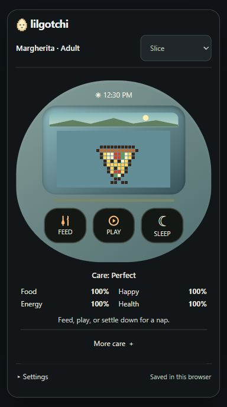

# 🥚 lilgotchi

A little pixel pet for your website. Feed it, play with it, and watch it grow.

**[Meet lilgotchi](https://www.taylordorsett.com/lilgotchi/)** · **[Character guide](docs/characters.md)** · **[Download](https://github.com/TaylorOD/lilgotchi/releases/latest)**

<p align="center">
  <a href="https://www.taylordorsett.com/lilgotchi/">
    
  </a>
</p>

## Four little families

| Family | Starts as |
| --- | --- |
| Slice | A ball of dough |
| Cypunk | A binary egg |
| Lilgotchi | Our little logo egg |
| Original | The classic egg |

Every family starts small and follows its own growth paths. Each keeps a separate save.

Feed, play, clean up and settle down for a nap. Progress stays in your browser, with file backups in Settings.

## Put one on your website

```html
<script defer src="https://www.taylordorsett.com/lilgotchi/releases/1.2.0/embed.js"></script>
```

That’s it. No account, backend or dependencies.

Use the [setup tool](https://www.taylordorsett.com/lilgotchi/) to pick your pets and placement. The [install guide](docs/install.md) covers hosting your own copy.

## Coming in 2.0

Seven more games, from catching notes to shooting hoops. The existing guessing game stays too. These are in development and are not in the hosted install yet. [See the game plans](design/games/README.md).

## Work on it

```sh
npm start
npm test
npm run build
```

Open [localhost:4176](http://localhost:4176). The build goes in `dist`.

[Development](docs/development.md) · [Care guide](docs/care.md) · [Release notes](docs/release-review.md)

## License

[MIT](LICENSE.md). Free to use, change and share. Keep the license and [required notices](pets/NOTICE.md) with redistributed copies.

[Credits](docs/credits.md)
